  

 

<a href="#features"><b>امکانات</b></a> &nbsp;&nbsp;|&nbsp;&nbsp;
<a href="#groups"><b>کانفیگ‌ها</b></a> &nbsp;&nbsp;|&nbsp;&nbsp;
<a href="#sub"><b>ساب‌لینک</b></a> &nbsp;&nbsp;|&nbsp;&nbsp;
<a href="#bot"><b>ربات فروش</b></a> &nbsp;&nbsp;|&nbsp;&nbsp;
<a href="#install"><b>نصب</b></a> &nbsp;&nbsp;|&nbsp;&nbsp;
<a href="#faq"><b>سوالات رایج</b></a>

 

**CHOST** یک پنل پاسارگاد معمولی نیست. نسخه‌ای اختصاصی و دست‌ساز است که از صفحه‌ی ورود تا ربات فروش، با یک هویت طلایی یکدست طراحی شده و فقط با یک دیپلوی روی Railway، کاملاً آماده‌ی فروش بالا می‌آید. پنل، هسته‌ی Xray، صفحه‌ی ساب، سرویس کلید و ربات تلگرام، همه داخل **یک سرویس** و روی **یک پورت** اجرا می‌شوند.

 

  

 

<b>جزئیات فنی کانفیگ‌ها</b>

 

| گروه | کانفیگ | پروتکل | انتقال | اثرانگشت |
|:--|:--|:--:|:--:|:--:|
| **CHOST VIP** | Turbo | VLESS | WebSocket | chrome |
| | Stream | VMess | WebSocket | firefox |
| | Ultra | VLESS | HTTPUpgrade | safari |
| **CHOST GAME** | Gaming | VLESS | WebSocket | chrome |
| | Call | Trojan | WebSocket | edge |
| | Stable | VLESS | HTTPUpgrade | ios |

همه روی **TLS 443** با دامنه‌ی خود Railway و با مسیرهای تصادفیِ مخصوص هر نصب. قالب‌های فروش آماده: VIP با 10، 30، 50، 100 و 200 گیگ و نامحدود؛ GAME با 20، 50 و 100 گیگ و نامحدود.

 

  

 

<b>همه‌ی امکانات ربات فروش</b>

 

| بخش | توضیح |
|:--|:--|
| **فروش** | انتخاب پلن، فاکتور با دکمه‌ی کپی، ارسال رسید، تأیید یا رد با ذکر دلیل، ساخت خودکار اشتراک |
| **تمدید** | تمدید از «اشتراک‌های من»؛ مصرف فقط بعد از ذخیره‌ی موفق صفر می‌شود |
| **کد تخفیف** | درصدی، با سقف استفاده، هر کاربر یک بار |
| **اکانت تست** | یک بار برای هر کاربر، حجم و مدت قابل تنظیم |
| **یادآوری** | کمتر از 3 روز، یا کمتر از 10 درصد حجم، یا کمتر از 1 گیگ |
| **بکاپ** | فایل کامل پنل و ربات، روزانه و دستی، در تلگرام مدیر |
| **مدیریت** | پلن‌ها، قیمت، شماره کارت، متن‌ها، عضویت اجباری کانال، پیام همگانی، باز و بسته کردن فروش |

 

  

## پنل نمایندگی و کلید مالک

**پنل نمایندگی** درست مثل بقیه‌ی بخش‌ها در منوی کناری پنل قرار دارد. مالک با چند کلیک برای هر نماینده یک حساب جدا با سهمیه‌ی حجم می‌سازد، سهمیه را افزایش می‌دهد، رمز را عوض می‌کند یا حساب را غیرفعال می‌کند. هر نماینده فقط کاربرهای خودش را می‌بیند و فقط با قالب‌های آماده کاربر می‌سازد.

**کلید مالک** برای روزی است که رمز فراموش شده: سرویس را ری‌استارت کنید، کلید را از لاگ بردارید و در صفحه‌ی ورود روی «دسترسی مالک» بزنید. کلید فقط 5 دقیقه اعتبار دارد، یک‌بارمصرف است، به‌صورت رمزنگاری‌شده ذخیره می‌شود و بعد از 5 تلاش اشتباه قفل می‌شود.

 

 

| بخش | آدرس |
|:--|:--|
| پنل | `https://<your-app>.up.railway.app/dashboard/` |
| ساب‌لینک | `https://<your-app>.up.railway.app/sub/<token>` |

> [!IMPORTANT]
> ورود اولیه با نام کاربری `admin` و رمز `admin` است. پنل روی اینترنت باز است؛ بلافاصله بعد از اولین ورود، از **تنظیمات، تغییر رمز عبور** رمز را عوض کنید.

<b>متغیرهای اختیاری</b>

 

| متغیر | پیش‌فرض | توضیح |
|:--|:--:|:--|
| `CONFIG_TITLE` | `CHOST` | نام اشتراک داخل برنامه‌ها |
| `SUBSCRIPTION_PATH` | `sub` | مسیر ساب‌لینک |
| `DEMO_RESELLER` | `on` | ساخت نماینده‌ی نمونه با 50 گیگ سهمیه |
| `AUTO_GROUP` | `off` | افزودن خودکار کاربرهای بدون گروه به VIP |

 

## سوالات رایج

<b>پینگ چقدر است؟</b>

 
بسته به اپراتور و لوکیشن Railway؛ معمولاً TCP بین 80 تا 150 و Real Delay بین 150 تا 300 میلی‌ثانیه. صفحه‌ی ساب پینگ واقعی را نشان می‌دهد، نه عدد ساختگی.

<b>روی کدام لوکیشن و اپراتور کار می‌کند؟</b>

 
همه‌ی لوکیشن‌های Railway (آمستردام، ویرجینیا، کالیفرنیا و سنگاپور) با IPv4 و IPv6. شش کانفیگ عمداً متفاوت ساخته شده‌اند تا روی همراه اول، ایرانسل، رایتل و اینترنت ثابت، اگر یکی محدود شد، بقیه وصل بمانند.

<b>چرا Reality یا Hysteria ندارد؟</b>

 
Railway فقط یک پورت HTTPS بیرون می‌دهد؛ پس فقط WebSocket و HTTPUpgrade پشت TLS پایدار کار می‌کنند.

<b>سرعت به چه چیزی بستگی دارد؟</b>

 
به شبکه و پلن Railway. پنل هیچ محدودیت سرعتی اعمال نمی‌کند.

<b>بکاپ را چطور برگردانم؟</b>

 
سرویس را متوقف کنید، فایل‌های زیپ بکاپ را در Volume جایگزین کنید و دوباره روشن کنید. راهنمای کوتاه داخل خود زیپ هم هست.

<b>با ری‌استارت کاربرها پاک می‌شوند؟</b>

 
خیر، به شرط اینکه Volume ساخته شده باشد.

 

<a href="INSTALL.md">راهنمای نصب</a> &nbsp;|&nbsp; <a href="FAQ.md">سوالات کامل</a> &nbsp;|&nbsp; <a href="TROUBLESHOOTING.md">عیب‌یابی</a> &nbsp;|&nbsp; <a href="SECURITY.md">امنیت</a> &nbsp;|&nbsp; <a href="CHANGELOG.md">تغییرات</a>

 

  

© 2026 CHOST. همه‌ی حقوق محفوظ است. بر پایه‌ی پروژه‌ی متن‌باز PasarGuard.

